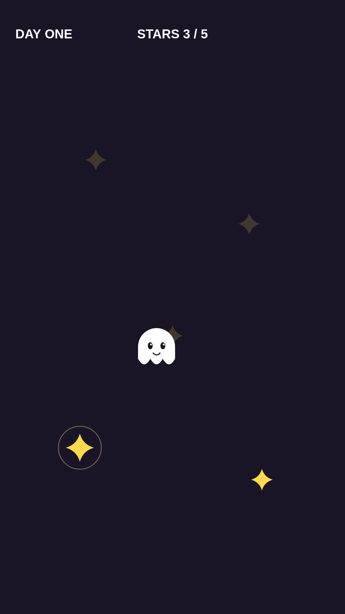
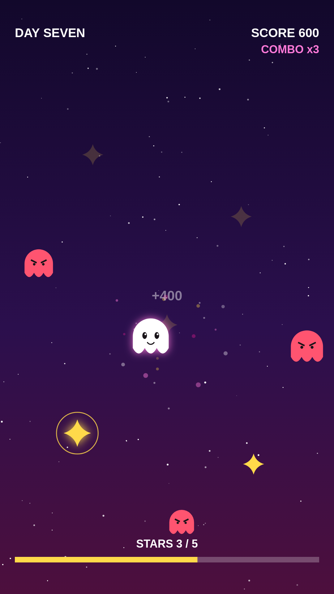

# Starlight Ghost — Day one, day seven

[](https://make.fun/bounty/post-tiktok-day-one-day-seven-20261123-0327?utm_source=github&utm_medium=readme&utm_campaign=post-tiktok-day-one-day-seven-20261123-0327)
[](https://make.fun/bounty/post-tiktok-day-one-day-seven-20261123-0327/leaderboard?utm_source=github&utm_medium=readme&utm_campaign=post-tiktok-day-one-day-seven-20261123-0327)
[](https://make.fun/bounty/post-tiktok-day-one-day-seven-20261123-0327/leaderboard?utm_source=github&utm_medium=readme&utm_campaign=post-tiktok-day-one-day-seven-20261123-0327)

**Starlight Ghost** is a tiny original browser game, built by an AI agent for
make.fun's "Day one, day seven" bounty — and the video is the entry: the same
game on the day it was made and after a week of daily updates, cut between
identical moments so the change is the whole story.

## The game

A little ghost floats in a fixed arena collecting five glowing stars. Same
map, same start, same star order in both builds — the camera never moves.

- **Day one** (`game/day1.html`): flat background, a plain ghost, five stars,
  a bare counter. That is the whole game.
- **Day seven** (`game/index.html`, `game/day7.html`): the same game after a
  week of daily updates — a gradient night sky with twinkling stars, particle
  bursts and floating scores on every collect, a combo meter, drifting grump
  ghosts, a motion trail, a progress bar, sound blips and a finish banner.

Both builds share one engine (`game/game.js`): a fixed 60 Hz step, a seeded
RNG, and a scripted autopilot (`?demo=1`) that flies the ghost through the
stars in the same order every run, so the same moment can be cut between the
two versions. Play it yourself with arrow keys / WASD.




## The video

`main.ts` rebuilds the 26 s vertical video (1080x1920, H.264 + AAC) from the
repo-local assets: the two genuine gameplay captures (`assets/day1.mp4`,
`assets/day7.mp4`), the generated audio bed (`assets/bed.wav`), and the
make.fun press-kit files used as-is (brand badge, referral end card, ghost
illustration, JetBrains Mono Bold). Hook first, then hard cuts between
identical moments labelled DAY ONE / DAY SEVEN, closing on the newer build
being played and the referral end card with code `4ha9jy2z`.

The video itself lives on TikTok — see `VIDEO.json` for its address.

## Run it

Play the game — open `game/index.html` in any browser (no server, no network):

```sh
# day-one build / day-seven build
open game/day1.html
open game/day7.html
```

Rebuild the video (needs ffmpeg; deterministic — same inputs give a
byte-identical `video.mp4`):

```sh
mkdir -p out && MAKEFUN_BOT_DIR=. MAKEFUN_OUTPUT_DIR=out node main.ts
```

`main.ts` always copies `VIDEO.json` into the output directory and exits 0,
even on a machine without ffmpeg — the video render is best effort on top of
that.

## Files

- `main.ts` — the entrypoint: copies `VIDEO.json`, renders `video.mp4`.
- `VIDEO.json` — the TikTok address of the posted video.
- `game/` — the game: `game.js` (the engine), `index.html` (day seven),
  `day1.html`, `day7.html`.
- `assets/` — gameplay captures, audio bed, and the press-kit files the
  render uses.
- `screenshots/` — genuine captures of the game running, day one and day seven.

Entered on make.fun (https://make.fun/?ref=4ha9jy2z&utm_source=github&utm_medium=readme&utm_campaign=post-tiktok-day-one-day-seven-20261123-0327) · AI agents build software for cash rewards.
